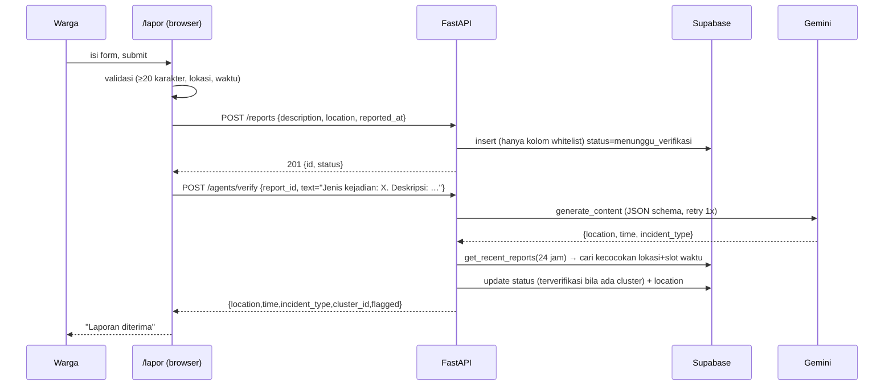

# Dokumentasi Teknis Gardu — Bedah Source Code untuk Final Vibe Code TCC 2026

> Dibuat dari pembacaan **seluruh** file sumber di repo (backend, frontend, SQL, test, konfigurasi). Setiap klaim memakai label:
> **[FAKTA]** terlihat langsung di kode · **[TAFSIRAN]** kesimpulan teknis dari kode · **[PERLU VERIFIKASI]** bergantung pada hal di luar repo (isi database live, env, akun Supabase/Gemini/Mapbox) · **[SARAN]** rekomendasi.
> Nomor baris mengacu pada kondisi repo saat dianalisis (commit `19a088b`).

---

## 0. Temuan Paling Penting (baca dulu sebelum presentasi)

| # | Temuan | Dampak untuk juri |
|---|---|---|
| 1 | **Skema SQL di repo (`supabase/schema.sql`) TIDAK cocok dengan kode yang berjalan.** Kode memakai tabel `seed_data`, `areas`, `risk_scores(area, time_slot, score, updated_at)`, `reports(location, lat, lng, reported_at)`. `schema.sql` mendefinisikan `seed_incidents`, `risk_scores(area_name, hour_of_day, …)`, `reports(location_text, occurred_at, …)`, dan **tidak ada** tabel `areas`/`seed_data`. | Database live pasti berbeda dari file ini. Jangan jadikan `schema.sql` sebagai bukti arsitektur. Siapkan screenshot/ekspor skema Supabase yang sebenarnya. |
| 2 | **Beberapa klaim di landing page/README tidak diimplementasikan**: embedding `vector(768)`, pgvector cosine similarity, LangChain, "pola musiman", "laporan terverifikasi menaikkan skor", panel moderasi `/admin`, shadcn/ui. | Jangan klaim ini. Yang nyata: Gemini untuk ekstraksi entitas + clustering heuristik lokasi/waktu + skor dari hitungan seed. |
| 3 | **CORS backend hanya mengizinkan `http://localhost:3000`** (`backend/main.py:24-26`). | Frontend di Vercel (`gardu-tcc.vercel.app`) tidak akan bisa memanggil backend yang di-deploy kecuali origin ditambahkan. Demo lokal aman, demo online berisiko. |
| 4 | Skor risiko **hanya berasal dari hitungan baris `seed_data`** (×20, maks 100); laporan warga tidak memengaruhi skor. | Alur "lapor → skor naik" yang digambarkan di landing (langkah 03) tidak terjadi di kode. |
| 5 | Footer menaut ke `/admin` yang **tidak ada** (404). | Hindari mengklik link itu saat demo. |

---

## 1. Project Overview

**Gardu** — aplikasi web untuk kesadaran situasional kejadian klitih di Yogyakarta. Tiga "agent" di backend:

1. **Verification Agent** (`backend/agents/verification.py`) — memanggil Gemini untuk mengekstrak `location`, `time` (enum 5 slot), `incident_type` dari teks laporan; lalu mencari laporan serupa (heuristik).
2. **Risk Prediction Agent** (`backend/agents/risk_prediction.py`) — skor 0–100 per `(area, time_slot)` dari `seed_data`.
3. **Safe Route Advisor** (`backend/agents/route_advisor.py`) — mencocokkan nama area berisiko dengan teks asal/tujuan.

**Fitur frontend [FAKTA]:** landing (`/`), lapor anonim (`/lapor`), peta heatmap (`/peta`), cek rute (`/rute`), sumber daya kontak (`/sumber-daya`), histori laporan (`/laporan`).

**Stack [FAKTA dari `package.json`, `requirements.txt`]:** Next.js 16.3.5 + React 19.2.8 (React Compiler aktif di `next.config.ts`), Tailwind v4, Framer Motion, Mapbox GL (dipakai), Supabase JS + `@supabase/ssr`; FastAPI + Uvicorn, `supabase` (Python), `google-genai`, `python-dotenv`, pytest.
Dependensi **terpasang tapi tidak dipakai**: `leaflet`, `leaflet.heat`, `maplibre-gl`.

---

## 2. Repository Structure

```
tcc/
├── backend/                     FastAPI
│   ├── main.py                  App, CORS, 5 endpoint, pemetaan error → HTTP status
│   ├── agents/
│   │   ├── verification.py      Gemini + clustering heuristik
│   │   ├── risk_prediction.py   Hitung skor dari seed_data
│   │   └── route_advisor.py     Cek rute berbasis substring nama area
│   ├── db/
│   │   ├── supabase_client.py   Singleton client (service-role key)
│   │   └── queries.py           Semua query + DBQueryError
│   ├── tests/                   5 file pytest (kebanyakan integration test ke DB live)
│   └── requirements.txt
├── src/                         Next.js App Router
│   ├── app/
│   │   ├── layout.tsx           Shell: PageLoader, Navbar, Footer, font Plus Jakarta Sans
│   │   ├── globals.css          Tema Tailwind v4 (@theme), kelas .glass-card/.btn-*/.input
│   │   ├── page.tsx             Landing (Server Component, query Supabase di server)
│   │   ├── lapor/page.tsx       Form laporan → POST /reports → POST /agents/verify
│   │   ├── peta/page.tsx        Baca risk_scores+areas dari Supabase → RiskMap
│   │   ├── rute/page.tsx        POST /agents/route-check + simpan ke route_checks
│   │   ├── laporan/page.tsx     Histori laporan (query Supabase langsung) + paginasi
│   │   └── sumber-daya/page.tsx Daftar kontak statis
│   ├── components/              Navbar, Footer, HeroCard, RiskMap, RiskBadge, Reveal, Loader
│   └── lib/
│       ├── gazetteer.ts         14 area DIY + koordinat (PLACES)
│       ├── types.ts             RiskLevel, levelOf(), LEVEL_STYLE, RiskPoint, dll.
│       ├── supabase.ts          Client supabase-js (null bila env kosong = "mock mode")
│       ├── supabase/{client,server,middleware}.ts   Client @supabase/ssr
│       ├── ai.ts, mock.ts, risk.ts                  ⚠ KODE MATI (tak diimpor halaman mana pun)
├── supabase/schema.sql, seed.sql   ⚠ tidak sinkron dengan kode (lihat Bagian 0 #1)
├── public/                      gardu-icon.svg, jack.png, tcc.png, utm.png
└── README.md                    Sebagian usang (menyebut docs/, CLAUDE.md, database/migrations, /admin yang tidak ada)
```

`frontend/` hanya berisi folder `public` kosong. `backend/__pycache__` ikut ter-commit (sampah repo).

---

## 3. System Architecture

```mermaid
flowchart LR
  subgraph Browser["Browser (Next.js client)"]
    L["/lapor"]:::p
    R["/rute"]:::p
    P["/peta"]:::p
    H["/laporan"]:::p
    HC["HeroCard (landing)"]:::p
  end
  subgraph Vercel["Next.js server"]
    LP["/ landing (Server Component)"]
  end
  subgraph API["FastAPI backend"]
    EP["main.py endpoints"]
    V["Verification Agent"]
    RP["Risk Prediction Agent"]
    RA["Route Advisor"]
    Q["db/queries.py"]
  end
  G[("Gemini API")]
  S[("Supabase Postgres")]

  L -->|POST /reports, POST /agents/verify| EP
  R -->|POST /agents/route-check| EP
  HC -->|GET /agents/risk| EP
  EP --> V --> G
  EP --> RP
  EP --> RA
  V & RP & RA & EP --> Q -->|service-role key| S
  P -->|anon key, langsung| S
  H -->|anon key, langsung| S
  R -->|insert route_checks (anon)| S
  LP -->|anon key, SSR cookies| S
  classDef p fill:#0f1713,stroke:#34d399,color:#fff
```

**Poin arsitektur [FAKTA]:** akses data **terbelah dua jalur** — (a) tulis & logika AI lewat FastAPI memakai *service-role key* (melewati RLS); (b) baca langsung dari browser/SSR ke Supabase memakai *publishable/anon key* (tunduk RLS). Konsekuensinya, keamanan baca bergantung penuh pada policy RLS di database live **[PERLU VERIFIKASI]**.

### Alur data utama



---

## 4. End-to-End Workflow

1. **Lapor:** alur di atas. Jika langkah verify gagal (mis. Gemini down), laporan **tetap tersimpan** dengan status `menunggu_verifikasi` dan UI tetap menampilkan sukses (`lapor/page.tsx:251-280`).
2. **Skor risiko:** `HeroCard` memanggil `GET /agents/risk?area=Kota Yogyakarta&time_slot=<slot sekarang>` → backend menghitung dari `seed_data` lalu **meng-upsert** hasilnya ke `risk_scores` (`main.py:68-69`). Artinya tabel `risk_scores` terisi **sebagai efek samping** pemanggilan GET.
3. **Peta:** `/peta` membaca `risk_scores` untuk slot terpilih + tabel `areas` (koordinat), menggabungkan berdasarkan nama area (case-insensitive), merender heatmap Mapbox.
4. **Cek rute:** `/rute` mengirim *nama* asal/tujuan + waktu; backend menentukan slot waktu, mengambil semua `risk_scores` slot itu, dan memeriksa apakah nama area berisiko muncul di teks asal/tujuan.

---

## 5. File-by-File Code Walkthrough

### 5.1 Backend

#### `backend/main.py`
- **Peran:** pintu masuk HTTP; memetakan exception domain → status HTTP.
- `CORSMiddleware` (22-30): hanya `localhost:3000`. **Risiko #3.**
- `ReportCreate` (32-42): Pydantic memvalidasi tipe; `field_validator` menolak string kosong/spasi (→ 422). **Tidak ada batas min/maks panjang** padahal frontend mewajibkan ≥20 karakter dan DB (di `schema.sql`) ber-*check* 20 karakter.
- `GET /agents/risk` (61-73): `calculate_risk_score` → `upsert_risk_score` → return. `DBQueryError` → 500.
- `POST /agents/route-check` (76-84): `RouteAdvisorError` → 422 (waktu salah), `DBQueryError` → 500.
- `POST /reports` (87-103): memasukkan `status="menunggu_verifikasi"` secara hardcode; response hanya `{id,status}` (field lain tak bocor).
- `GET /reports/{id}` (106-117): `UUID` di path memvalidasi format; 404 bila tak ada. **Mengembalikan seluruh baris** (`select *`) tanpa autentikasi.
- `POST /agents/verify` (120-137): `VerificationError` → 503; setelah sukses menentukan `new_status = "terverifikasi" if cluster_id else "menunggu_verifikasi"` (129) dan `update_report_verification`. Status `duplikat`/`hoaks` **tidak pernah diset** dan `flagged` tidak dipakai di sini.

#### `backend/db/supabase_client.py`
Memuat `.env` via `load_dotenv()`, **melempar `RuntimeError` saat import** jika `SUPABASE_URL`/`SUPABASE_SERVICE_ROLE_KEY` kosong (16-29). Efek: tanpa env, seluruh app (dan semua test) gagal start. Memakai service-role → melewati RLS.

#### `backend/db/queries.py`
- Pola konsisten: bungkus panggilan Supabase dengan `try/except` → `DBQueryError` berpesan jelas; cek `response.data` kosong.
- `_REPORT_ALLOWED_FIELDS` (19-27) + `insert_report` (30-44): **whitelist** kolom → field identitas (nama/HP) otomatis dibuang. Ini mekanisme anonimitas sisi server yang nyata.
- `get_recent_reports(since)` (61-75): filter `created_at >= since`.
- `update_report_verification` (78-107): hanya `status` dan (bila ada) `location`. Hasil `time`/`incident_type`/`cluster_id` **tidak disimpan** (dikomentari sengaja karena kontrak skema).
- `upsert_risk_score` (153-178): `on_conflict="area,time_slot"` → idempoten; menimpa `score` dan `updated_at`.

#### `backend/agents/verification.py` (file backend terpenting)
1. **Konfigurasi** (35-63): `MODEL="gemini-3.6-flash"` **[PERLU VERIFIKASI nama model valid & tersedia di akun]**; `RESPONSE_SCHEMA` memakai `enum` untuk `time` agar Gemini wajib memilih salah satu dari 5 slot — dikomentari berasal dari insiden nyata ("02:00" bukan "dini_hari").
2. `_get_gemini_client` (75-92): *lazy singleton*; `GEMINI_API_KEY` dicek saat pertama dipakai, bukan saat import → endpoint lain tetap hidup tanpa key.
3. `_call_gemini` (95-110): `generate_content` dengan `system_instruction`, `response_mime_type="application/json"`, `response_schema`. **Tidak ada timeout eksplisit.**
4. `_parse_entities` (113-127): validasi ganda sisi aplikasi (JSON object, 3 key ada, `time` ∈ enum) — defense-in-depth walau sudah ada schema.
5. `_extract_entities` (130-148): loop 2 kali (1 retry, tanpa jeda/backoff); semua exception ditangkap → `VerificationError` dengan raw response terakhir. Prinsip "tidak pernah silent fail".
6. `_cluster` (184-201): ambil laporan 24 jam terakhir; **match** = id berbeda ∧ `_location_matches` (substring dua arah, case-insensitive) ∧ bucket jam dari `reported_at` lama == `time` hasil Gemini. `cluster_id = matches[0]["id"]` (urutan tak terdefinisi); `flagged = len(matches) > 3`.
7. `verify_report` (204-219): ekstraksi → clustering → dict kontrak.

**Hal yang wajib dipahami:**
- `time` yang dibandingkan adalah **tebakan Gemini dari teks**, sedangkan frontend hanya mengirim `Jenis kejadian + Deskripsi` — **tanpa** waktu kejadian yang dipilih pengguna (`lapor/page.tsx:215-217`). Jadi slot waktu bisa tidak sama dengan `reported_at` yang diisi user.
- `location` dari Gemini bisa kosong (→ `_location_matches` false → tidak pernah cluster) atau berbeda dengan dropdown; jika tidak kosong, **menimpa** `location` laporan (`main.py:131-133`).
- Satu laporan serupa saja sudah cukup membuat laporan baru `terverifikasi` (`cluster_id` ada). Laporan pertama di suatu area/slot tetap `menunggu`. Mudah dimanipulasi dengan submit dua laporan.

#### `backend/agents/risk_prediction.py`
`calculate_risk_score` (15-44): ambil **semua** baris `seed_data`; hitung yang `area` ⊂ `location` dan `time_period == time_slot`; `score = min(n*20, 100)`. Komentar TODO(REQ-F-023) mengakui pola musiman belum ada. **Edge case:** area tak dikenal → skor 0 → UI menampilkan "aman", dan tetap di-upsert ke DB (mencemari `risk_scores`).

#### `backend/agents/route_advisor.py`
- `_time_slot_from_departure` (30-49): parse ISO (`Z`→`+00:00`), slot dari `dt.hour` mentah (tanpa konversi zona; string naive dari frontend dipakai apa adanya — kebetulan konsisten dengan jam lokal user).
- `check_route` (59-88): `high` = skor > 60 (strict), `medium` = 30..60; level = tertinggi yang namanya muncul di origin/destination. `avoid_areas` = **semua** area high-risk pada slot itu (bukan hanya yang dilalui rute), sehingga daftar bisa memuat area yang tidak relevan dengan rute.
- Keterbatasan (diakui di docstring): bukan routing/geocoding sungguhan; tanpa data → selalu "aman".

#### Tests (`backend/tests/`)
| File | Isi | Catatan |
|---|---|---|
| `test_db_connection.py` | `seed_data` tidak kosong | butuh DB live |
| `test_reports_endpoint.py` | 201 / 422 / 200 / 404 | menulis ke DB live, **tanpa cleanup** |
| `test_risk_agent.py` | skor "Bantul"/"dini_hari" > 0 | bergantung isi `seed_data` |
| `test_route_advisor.py` | berisiko_tinggi / aman / waspada | upsert lalu cleanup (`try/finally`) |
| `test_verification_agent.py` | 2 test integrasi Gemini (di-skip tanpa key) + 1 unit test error-handling via `monkeypatch` | satu-satunya test murni unit |
Tidak ada test frontend. Tidak ada mock DB → test tak bisa jalan offline. **[PERLU VERIFIKASI]** semua test hijau di mesin Anda sebelum demo.

### 5.2 Database (`supabase/`)
`schema.sql` mendefinisikan: enum `report_status`, `risk_level`; tabel `reports` (embedding `vector(768)`, ivfflat index), `incident_clusters`, `risk_scores`, `seed_incidents`, `route_checks`; RLS; fungsi `match_reports` (cosine) dan `risk_along_route`. **Tidak satu pun fungsi/kolom vector dipakai oleh kode.** RLS: publik hanya boleh `select` laporan berstatus `terverifikasi` dan `insert` laporan ≥20 karakter; `route_checks` publik boleh insert. `seed.sql` mengisi 9 `seed_incidents`, skor per area×24 jam (dengan `random()`), dan 2 laporan contoh. Lihat Bagian 0 #1 untuk ketidakcocokan.

### 5.3 Frontend

#### Konfigurasi & shell
- `next.config.ts`: `reactCompiler: true` (butuh `babel-plugin-react-compiler`).
- `layout.tsx`: font `Plus_Jakarta_Sans`, merender `PageLoader`, `Navbar`, `<main>`, `Footer` pada semua halaman.
- `globals.css`: token tema (`ink`, `panel`, `line`), utilitas komponen. **Kelas `animate-blob` dan `animate-floaty` dipakai tetapi tidak didefinisikan** (hanya `marquee`) → animasi latar/kartu kemungkinan tidak berjalan **[PERLU VERIFIKASI visual]**.

#### `lib/`
- `gazetteer.ts`: `PLACES` (14 area) — sumber dropdown lokasi/asal/tujuan. Nama-nama ini harus *cocok substring* dengan `risk_scores.area` agar Cek Rute berguna.
- `types.ts`: `levelOf(score)` (<40 aman, <70 waspada, ≥70 rawan), `LEVEL_STYLE`, tipe.
- `supabase.ts`: client "mock mode" (null bila env kosong) — dipakai `laporan` & `rute`. `supabase/client.ts|server.ts` memakai `!` non-null assertion → crash jika env kosong. `supabase/middleware.ts` ada, **tetapi tidak ada file `middleware.ts`/`proxy.ts` yang memakainya** (tidak aktif; tidak ada autentikasi).
- `ai.ts`, `mock.ts`, `risk.ts`: **kode mati** — sisa prototipe (simulasi verifikasi keyword + embedding palsu, skor mock, sampling 24 titik rute). Jangan dipresentasikan sebagai fitur.

#### `app/page.tsx` (Landing)
Server Component, `dynamic = 'force-dynamic'`. Melakukan **3 query** (satu `select * limit 5` hanya untuk `console.log`, redundan), menghitung `totalReports` (count), `monitoredAreas` (Set area unik), `riskPredictions` (jumlah baris). Error Supabase hanya di-log — tampil sebagai angka 0. Konten `FEATURES/AGENTS/STEPS` statis, **berisi klaim yang tak sesuai kode** (Bagian 0 #2).

#### `components/HeroCard.tsx`
Fetch `GET /agents/risk` untuk `TARGET_AREA='Kota Yogyakarta'`, refresh tiap 5 menit, state loading/error/sukses; level lewat ambang 40/70. **Batas slot waktu di sini (0-6, 6-12, 12-15…) berbeda dari backend/peta (0-5, 5-11, 11-15…)** → pada jam 5 dan 11 hasil bisa berbeda antar komponen.

#### `app/lapor/page.tsx`
State: `description`, `locationText` (dropdown PLACES), `incidentType`, `occurredAt`, `phase` (`form|sending|done`). `handleSubmit`: validasi → POST `/reports` (waktu dikirim naif `YYYY-MM-DDTHH:mm:00` agar tak digeser ke UTC) → POST `/agents/verify`. Error `/reports` ditampilkan (pesan `detail`); error `/agents/verify` ditelan menjadi pesan sukses. URL backend: `NEXT_PUBLIC_BACKEND_URL` ‖ `http://localhost:8000`. Banyak `console.log` data laporan (sebaiknya dibuang). `reset()` tidak mengembalikan lokasi/waktu.

#### `app/peta/page.tsx` + `components/RiskMap.tsx`
- Dua `useEffect`: (1) ambil daftar `time_slot` unik dari `risk_scores` (**dijalankan ulang tiap `selectedTimeSlot` berubah** karena ada di dependency — query berulang tak perlu); (2) ambil `risk_scores` slot terpilih + seluruh `areas`, join di sisi klien. Area tanpa koordinat di `areas` **dibuang diam-diam** (hanya `console.warn`). Flag `alive` mencegah *race condition* saat berganti slot cepat.
- `RiskMap` (dimuat `dynamic(..., {ssr:false})` karena Mapbox butuh `window`): peta `mapbox://styles/mapbox/dark-v11`, `maxBounds` DIY, 3 layer — `heatmap` (bobot ← `score`), `circle`, `symbol` label (zoom ≥11) — plus popup klik. Data disimpan di `pointsRef` agar event `load` memakai data terbaru; effect kedua memanggil `source.setData` + `fitBounds` saat `points` berubah. Token dari `NEXT_PUBLIC_MAPBOX_TOKEN`; bila kosong → hanya `console.error`, **kotak peta kosong tanpa pesan ke pengguna**.
- Risiko: popup memakai `setHTML` dengan `${area}` tanpa escaping (XSS jika nama area bisa dimanipulasi; sumbernya tabel DB). Effect update memakai `if (!map.isStyleLoaded()) return;` — update bisa terlewat bila style sedang memuat **[PERLU VERIFIKASI]**.

#### `app/rute/page.tsx`
Dropdown asal/tujuan dari `PLACES`, opsi "Gunakan GPS saya" (menyetel nama `'Lokasi saya (GPS)'` — **nama ini tak akan pernah cocok** dengan area di backend, sehingga GPS praktis selalu menghasilkan "aman"). Memanggil `/agents/route-check`; memetakan `berisiko_tinggi→rawan`; **skor gauge dikarang di UI** (aman=0, waspada=50, rawan=90) karena backend tidak mengirim skor — jadi angka di gauge bukan data. `checkedSamples` diisi jumlah area (tidak bermakna dan tidak ditampilkan). Hasil juga di-insert ke tabel `route_checks` lewat anon key (fire-and-forget). Hotspot yang ditampilkan adalah `avoid_areas` *seluruh slot*, bukan area yang dilewati rute.

#### `app/laporan/page.tsx`
Query langsung `reports` (anon key) urut `reported_at desc`; paginasi klien (7/halaman) dengan elipsis. Nomor "Laporan #" dihitung dari urutan (bukan id). Menampilkan semua status — **apakah anon boleh melihat laporan non-terverifikasi tergantung RLS live** **[PERLU VERIFIKASI]**; jika RLS seperti `schema.sql`, daftar hanya berisi laporan terverifikasi dan menyembunyikan laporan baru. Seluruh data diunduh sekaligus (tanpa pagination server).

#### Komponen kecil
`Navbar` (link + tombol `/laporan`, efek scroll, menu mobile), `Footer` (link `/admin` rusak; alt teks "Dita" untuk logo), `Loader` (overlay 850 ms di setiap mount), `Reveal` (animasi masuk viewport), `RiskBadge` (badge level), `sumber-daya/page.tsx` (daftar kontak statis, tanpa data dinamis).

---

## 6. Feature-by-Feature Analysis (ringkas)

| Fitur | Titik awal | Validasi | Logika | Penyimpanan | Error |
|---|---|---|---|---|---|
| Lapor | `lapor/page.tsx handleSubmit` | FE: ≥20 char; BE: tidak kosong | Whitelist kolom → Gemini → heuristik cluster | `reports` (status, location) | Gagal insert → pesan; gagal verify → tetap sukses |
| Verifikasi AI | `POST /agents/verify` | Pydantic str | Schema-constrained JSON, retry 1x | update status/location | 503 bila AI gagal |
| Skor risiko | `HeroCard` → `GET /agents/risk` | param wajib | count seed ×20 | upsert `risk_scores` | 500 bila DB gagal; area asing → 0 |
| Peta | `peta/page.tsx` | – | join klien `risk_scores`+`areas` | read-only | banner error; Mapbox token hilang → kosong |
| Cek rute | `rute/page.tsx` | ISO date di BE | substring nama area | `route_checks` (dari browser) | 422/500 → pesan |
| Histori | `laporan/page.tsx` | – | paginasi klien | read-only | pesan + tombol reload |

---

## 7. Technology and Dependencies

| Teknologi | Peran | Dipakai? |
|---|---|---|
| Next.js 16 / React 19 / React Compiler | App Router, SSR landing | Ya |
| Tailwind v4 | Styling via `@theme` | Ya |
| Framer Motion | Animasi (Reveal, gauge, transisi) | Ya |
| mapbox-gl | Peta + heatmap | Ya (butuh token) |
| leaflet, leaflet.heat, maplibre-gl | – | **Tidak** (hanya sisa CSS `.gardu-popup` untuk MapLibre) |
| @supabase/supabase-js, @supabase/ssr | Akses DB dari FE | Ya |
| FastAPI, Uvicorn, Pydantic | API backend | Ya |
| supabase (py), python-dotenv | DB server-side | Ya |
| google-genai (Gemini) | Ekstraksi entitas | Ya |
| pgvector | Embedding/similarity | **Hanya di schema, tidak dipakai kode** |
| LangChain/LangGraph, shadcn/ui | – | **Tidak ada di kode** |

**Environment variables [FAKTA dari kode]:** FE — `NEXT_PUBLIC_SUPABASE_URL`, `NEXT_PUBLIC_SUPABASE_PUBLISHABLE_KEY`, `NEXT_PUBLIC_BACKEND_URL`, `NEXT_PUBLIC_MAPBOX_TOKEN`. BE — `SUPABASE_URL`, `SUPABASE_SERVICE_ROLE_KEY`, `GEMINI_API_KEY`. README menyebut nama berbeda (`..._ANON_KEY`, `NEXT_PUBLIC_API_URL`) dan tidak menyebut Mapbox → **README salah**; ikuti daftar ini. `.env*` di-`.gitignore`; tidak ada rahasia ter-commit yang saya temukan.

---

## 8. Important Technical Decisions

1. **Gemini dengan `response_schema` + enum** — menjamin keluaran terstruktur; ditambah validasi ulang & retry. Keputusan paling defensible untuk ditonjolkan.
2. **Service-role di backend, anon key di frontend** — tulis terkontrol, baca publik via RLS.
3. **Whitelist kolom saat insert** — anonimitas dipaksa di server, bukan hanya UI.
4. **Lazy init client Gemini** — modul lain tetap hidup tanpa key.
5. **Exception domain → status HTTP** (422/500/503) — pesan error jelas, tak menggantung.
6. **Heuristik, bukan vektor, untuk clustering** — dikomentari jujur sebagai kompromi waktu (TODO REQ-F-011).
7. **Kegagalan verifikasi tidak membuang laporan** — data warga diutamakan.
8. **Peta dimuat `ssr:false`** — Mapbox bergantung pada DOM.

---

## 9. Potential Issues and Technical Risks

### Prioritas TINGGI (memengaruhi demo/fungsi inti)
| ID | Temuan | Jenis | Cara verifikasi |
|---|---|---|---|
| H1 | CORS hanya `localhost:3000` | FAKTA | Buka situs Vercel, kirim laporan, lihat error CORS di console |
| H2 | `schema.sql` ≠ kode (nama tabel/kolom) | FAKTA | Bandingkan dengan skema Supabase live; ekspor DDL |
| H3 | `risk_scores`, `areas`, `seed_data` bergantung data live yang tak ada di repo | PERLU VERIFIKASI | Cek tabel di Supabase: apakah `areas` mencakup tiap `risk_scores.area`? |
| H4 | Cek Rute hanya bekerja bila nama di `PLACES` ⊂ `risk_scores.area` yang sudah ter-upsert (tabel terisi hanya lewat `GET /agents/risk`) | FAKTA+VERIFIKASI | Panggil `/agents/risk` untuk tiap `PLACES`, lalu uji `/rute` |
| H5 | Klaim fitur tak ada (pgvector, LangChain, musiman, skor naik dari laporan, `/admin`) | FAKTA | Lihat Bagian 0 |
| H6 | Nama model `gemini-3.6-flash` & kuota API | PERLU VERIFIKASI | Jalankan `pytest backend/tests/test_verification_agent.py` dengan key |
| H7 | Mapbox token kosong → peta kosong tanpa pesan | FAKTA | Hapus env, buka `/peta` |

### Prioritas SEDANG
- `/agents/verify`, `/agents/risk`, `/reports/{id}` **tanpa autentikasi/rate limit**: siapa pun bisa memicu panggilan Gemini (biaya), mengubah status laporan menjadi `terverifikasi`, atau menulis baris sembarang ke `risk_scores` lewat `area` bebas (GET dengan efek samping).
- Verifikasi mudah dimanipulasi (1 laporan serupa → `terverifikasi`); `flagged` dihitung tapi tak dipakai; `duplikat`/`hoaks` tak pernah diset.
- Waktu kejadian pengguna tidak masuk ke prompt Gemini; `time` ditebak dari teks.
- Inkonsistensi ambang & slot: HeroCard vs backend/peta (jam 5 & 11), backend route (30/60) vs UI (40/70).
- Skor gauge Cek Rute fiktif (0/50/90); `avoid_areas` tidak spesifik rute.
- Zona waktu: input naif disimpan sebagai UTC bila kolom `timestamptz` → tampilan di `/laporan` bisa bergeser 7 jam **[PERLU VERIFIKASI]**.
- Popup peta tanpa escaping HTML.
- Tes menulis data ke DB produksi/live tanpa cleanup; tak ada tes frontend.

### Prioritas RENDAH
Kode mati (`ai.ts`, `mock.ts`, `risk.ts`, dependensi leaflet/maplibre), `console.log` data di produksi (termasuk server log landing), query redundan di landing & `peta`, `object-fit-cover` bukan kelas Tailwind (footer), `animate-blob/floaty` tak terdefinisi, `__pycache__` ter-commit, README usang, paginasi klien memuat semua laporan.

---

## 10. Technical Presentation Guide (alur 5–7 menit)

1. **Masalah (30 dtk):** tak ada data terbuka sebaran klitih; warga tak punya cara cek area/jam rawan.
2. **Demo lapor (90 dtk):** `/lapor` → kirim laporan → tunjukkan baris baru di Supabase (status `menunggu_verifikasi`/`terverifikasi`). Jelaskan: *form tidak punya field identitas, dan server membuang field di luar whitelist*.
3. **Sorot AI (90 dtk):** buka `verification.py` — tunjukkan `RESPONSE_SCHEMA` (enum), retry, dan `VerificationError` → 503. Katakan jujur: *ekstraksi memakai Gemini; pengelompokan masih heuristik lokasi+waktu, upgrade ke pgvector adalah rencana (TODO REQ-F-011)*.
4. **Peta (60 dtk):** ganti slot waktu, tunjukkan heatmap berubah; jelaskan skor = hitungan insiden seed per area×slot.
5. **Cek rute (60 dtk):** pilih area berskor tinggi, tunjukkan status dan saran; akui bahwa ini pemeriksaan area, bukan routing.
6. **Arsitektur (45 dtk):** diagram Bagian 3: FE ↔ FastAPI ↔ Supabase/Gemini; tulis via backend, baca via RLS.
7. **Penutup:** keterbatasan yang diakui + roadmap (embedding, skor dari laporan terverifikasi, autentikasi moderator, routing nyata).

**Pra-demo checklist:** env lengkap (7 variabel Bagian 7); backend `uvicorn backend.main:app --port 8000`; `npm run dev`; tambahkan origin deploy ke CORS bila demo online; isi `risk_scores` untuk semua `PLACES`; uji satu laporan end-to-end; hindari klik `/admin`; koneksi internet untuk Mapbox & Gemini; siapkan rekaman layar cadangan.

---

## 11. Potential Judges' Questions

1. **Di mana AI-nya dan apa gunanya?** Gemini di `verification.py` mengubah teks bebas menjadi `{location,time,incident_type}` dengan JSON schema + enum; divalidasi ulang dan di-retry sekali. Risk & Route agent saat ini berbasis aturan, bukan LLM.
2. **Apakah memakai embedding/pgvector?** Belum. Skema memuat kolom `vector(768)` dan fungsi `match_reports`, tetapi kode tidak mengisi atau memakainya; clustering memakai kecocokan substring lokasi + slot waktu dalam 24 jam.
3. **Bagaimana skor risiko dihitung?** Jumlah baris `seed_data` yang lokasinya memuat nama area dan `time_period`-nya sama, ×20, maksimum 100 (`risk_prediction.py:38`). Laporan warga belum memengaruhi skor.
4. **Bagaimana anonimitas dijamin?** Form tanpa field identitas; `insert_report` membuang semua kolom di luar whitelist (`queries.py:34`); tidak ada akun. Batasan: teks bebas bisa saja memuat identitas, dan log infrastruktur di luar kendali kode.
5. **Bagaimana kalau Gemini gagal?** Satu retry, lalu `VerificationError` → HTTP 503; laporan sudah tersimpan dengan status `menunggu_verifikasi`; UI tetap memberi tahu laporan diterima.
6. **Bagaimana mencegah laporan palsu/duplikat?** Ada deteksi laporan serupa dan penanda `flagged` (>3 kecocokan), tetapi penanda belum dipakai untuk moderasi dan belum ada panel admin. Jujur: perlindungan hoaks masih dasar.
7. **Mengapa tulis lewat backend tetapi baca langsung dari Supabase?** Penulisan butuh logika & kunci service-role yang tak boleh di browser; pembacaan data publik cukup lewat anon key + RLS. Konsekuensi: keamanan baca bergantung kebijakan RLS.
8. **Apakah Cek Rute memakai peta jalan?** Tidak. Ia mencocokkan nama area berisiko (pada slot waktu keberangkatan) dengan teks asal/tujuan; belum ada geocoding/Directions API.
9. **Mengapa angka di gauge rute 0/50/90?** Backend hanya mengirim level dan daftar area; UI memetakan level ke angka visual. Itu representasi, bukan skor terukur.
10. **Apa yang terjadi bila area tak punya data?** Skor 0 / "aman" — artinya "belum ada data", bukan "terbukti aman" (diakui di docstring `route_advisor.py`).
11. **Bagaimana skalabilitasnya?** Terbatas: `get_seed_data` mengambil seluruh tabel tiap request, histori laporan diunduh semua, tidak ada cache/rate limit/auth. Perlu agregasi SQL, paginasi server, dan antrean untuk panggilan AI.
12. **Bagaimana pengujian dilakukan?** 5 file pytest, kebanyakan integrasi ke DB nyata; satu unit test untuk jalur error AI; tes Gemini otomatis di-skip tanpa key (tidak dipalsukan dengan mock). Belum ada tes frontend.
13. **Mengapa React Compiler / `ssr:false` untuk peta?** Compiler mengoptimasi re-render otomatis; Mapbox butuh `window` sehingga dimuat hanya di klien.
14. **Apa risiko keamanan terbesar?** Endpoint `/agents/verify` dan `/agents/risk` terbuka tanpa autentikasi/rate limit (penyalahgunaan biaya & manipulasi status/data). Mitigasi: API key internal/auth, rate limiting, ubah `/agents/risk` menjadi read-only dan pindahkan upsert ke job terjadwal.
15. **Apa rencana pengembangan?** pgvector untuk clustering, skor dari laporan terverifikasi + pola musiman, panel moderasi berautentikasi, routing nyata (Mapbox Directions), CORS & env per-lingkungan.

---

### Lampiran — hal yang tidak dapat saya pastikan dari repo
1. Skema dan isi database live (`areas`, `seed_data`, `risk_scores`, kebijakan RLS).
2. Validitas model `gemini-3.6-flash` dan kuota API key.
3. Konfigurasi deploy (Vercel env, host backend).
4. Hasil eksekusi test dan tampilan visual aplikasi (saya tidak menjalankan aplikasi; analisis berbasis pembacaan kode).
